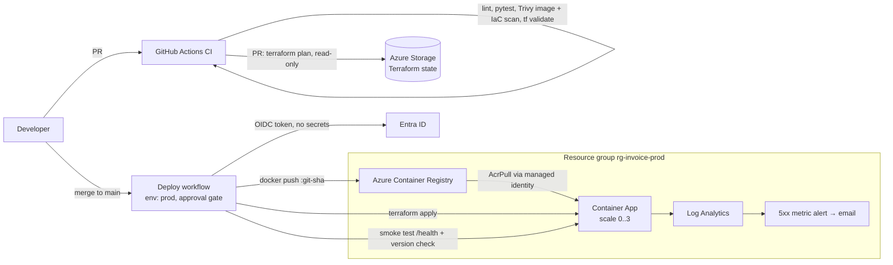

# Azure CI/CD Showcase: Invoice API on Container Apps

A small containerized API deployed to **Azure Container Apps** through a fully automated pipeline:
**GitHub Actions → Azure Container Registry → Terraform → Container Apps**, with no stored cloud credentials.

The app is deliberately tiny. The point is the delivery pipeline and the platform around it.

## Architecture



## What this demonstrates

| Concern | How it's handled |
|---|---|
| **Auth without secrets** | GitHub OIDC federated credential; Azure trusts a short-lived token per job. No client secrets in GitHub. |
| **Least privilege** | CI identity has Contributor + User Access Administrator on one resource group only, plus blob access to the state account. The app pulls images with its own managed identity that has `AcrPull` on one registry. ACR admin user is disabled. |
| **Infrastructure as code** | Terraform with remote state in Azure Storage (AAD auth, shared keys disabled, state locking). |
| **Shift-left security** | Trivy scans the image (CRITICAL/HIGH) and the Terraform (misconfigurations) on every PR. Multi-stage, non-root Dockerfile. |
| **Safe change process** | PRs get a `terraform plan` in the job summary. Deploys run in a `prod` GitHub Environment, which can require reviewers. A concurrency group serializes applies. |
| **Immutable deploys** | Images are tagged with the git SHA, never `latest`. `/health` reports the running version, and the smoke test fails the pipeline if it doesn't match the commit. |
| **Cost awareness** | Scale-to-zero Container Apps, Basic ACR, 30-day log retention. Roughly a few dollars/month idle. `scripts/teardown.sh` removes everything. |
| **Observability** | Container logs flow to Log Analytics; HTTP liveness/readiness probes; metric alert on 5xx. |

## Repo layout

```
app/        FastAPI service, tests, Dockerfile
infra/      Terraform (ACR, Log Analytics, Container Apps env + app, identity, alerts)
scripts/    bootstrap.sh (one-time setup), teardown.sh
.github/workflows/
  ci.yml      PR checks: lint, test, build, scan, tf validate, tf plan
  deploy.yml  main: CI gate → build/push → terraform apply → smoke test
```

## Run it yourself

Prereqs: Azure subscription, `az`, `gh`, a GitHub repo for this code.

```bash
az login
./scripts/bootstrap.sh <your-github-user>/azure-cicd-showcase   # state storage, OIDC identity, repo variables
# In GitHub: Settings > Environments > New environment "prod" (optionally add required reviewers)
git push origin main                                           # triggers the pipeline
```

Local app only:

```bash
cd app && pip install -r requirements-dev.txt && pytest && uvicorn main:app --reload
```

When done: `./scripts/teardown.sh`.

## Design decisions and trade-offs (good interview material)

- **Why Container Apps, not AKS?** It gives scale-to-zero, revisions and ingress without cluster operations. For one stateless API, AKS is more to run for no benefit. I'd move to AKS for custom networking, many services or operators.
- **Why Terraform, not Bicep?** It's multi-cloud and widely used, and the state-locking and plan-review workflow carries over to any provider. Bicep would be a fine Azure-only choice.
- **The registry bootstrap.** The Container App can't be created until its image exists in ACR, so the deploy applies only the registry first (`-target`), pushes the image, then applies the full stack. It's idempotent, but it's a pragmatic workaround. The alternative is splitting into two Terraform stacks (platform and app).
- **Rebuilding the image in deploy.** CI builds and scans the image, then deploy rebuilds it. A stricter pipeline would build once, scan, and promote the same digest. That's the next improvement.
- **In-memory data.** The app keeps invoices in memory to keep the demo cheap. A real service would use Azure SQL or Cosmos DB with credentials in Key Vault via managed identity.

## Possible extensions

- Build once and promote by digest, with image signing (cosign) and SBOM
- Separate `dev` / `prod` environments with a promotion step
- Private networking (VNet-integrated environment, private ACR endpoint)
- Blue/green or canary using Container Apps revision traffic splitting
- Azure SQL + Key Vault, and Application Insights tracing
